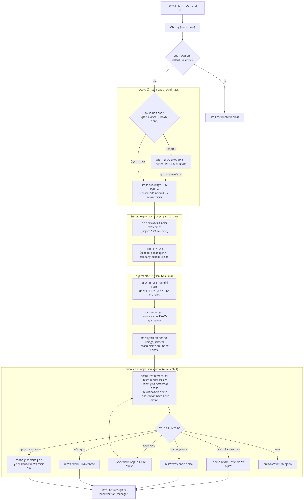
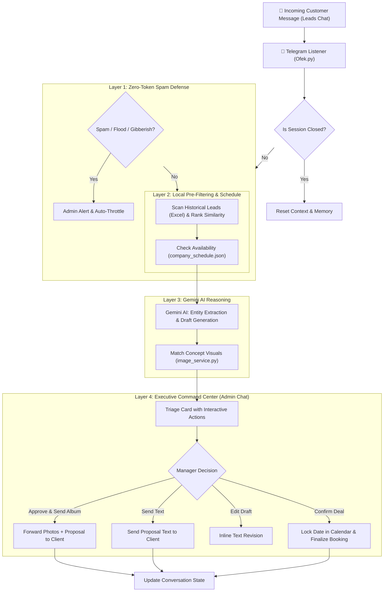

# 🌟 EventTriage AI

<div align="center">


**Next-Generation Autonomous Event Concierge & Intelligent Booking Pipeline**  
*Seamless multi-turn customer dialogues, calendar availability sync, zero-token spam defense, and Human-in-the-Loop executive deal closure via Telegram.*

[Key Features](#-key-features) • [Architecture](#-system-architecture) • [Quick Start](#-quick-start) • [Project Structure](#-project-structure) • [Configuration](#-configuration)

</div>

---

## 📌 Overview

**EventTriage AI** is a production-grade conversational sales agent and event triage engine designed for high-end event production agencies. Operating directly within **Telegram**, it handles incoming customer inquiries, gathers requirements, assesses calendar feasibility, references past production history, and drafts tailored proposals.

To guarantee 100% brand safety and precision, the agent operates on a **Human-in-the-Loop (HITL)** paradigm: every AI-generated response and proposed deal is dispatched to a private executive management channel for one-click verification, revision, or instant deal closing.

---

## 🚀 Key Features

* **🛡️ Zero-Token Anti-Spam Shield (Layer 1):**  
  High-speed pure Python heuristic filter detecting message flooding, duplicates, and commercial spam without consuming a single LLM API token.

* **⚡ Smart Historical Pre-Filtering (Layer 2):**  
  Instantly scores and matches incoming requests against 100+ historical corporate and private event leads (`event_leads_history.xlsx`), feeding only the top relevant candidates to the AI for a **95% token cost reduction**.

* **📅 Real-Time Calendar Engine:**  
  Directly checks schedule availability against `company_schedule.json`. Automatically recognizes occupied dates, suggests alternatives, and locks approved slots upon closing.

* **🧠 Advanced Gemini Cognitive Triage (Layer 3):**  
  Extracts event entities (date, guest count, budget, venue preferences, event style), detects customer sentiment, and formulates natural, clean proposal drafts.

* **🖼️ Multimodal Concept Image Pairing:**  
  Matches inquiries with curated high-resolution event concept photos (corporate galas, beach events, boutique chef dinners, desert celebrations) to accelerate client visualization.

* **🎛️ Executive Command Center (Layer 4 - Telegram HITL):**  
  Delivers interactive management cards with inline buttons:
  * `[✅ Approve & Send + 2 Images]`
  * `[💬 Send Text Only]`
  * `[✏️ Edit Draft Directly]`
  * `[📞 Share Direct Phone (Escalation)]`
  * `[🎉 Confirm Deal & Book Calendar]`

---

## 🏗️ System Architecture



### End-to-End Workflow



---

## 📁 Project Structure

```bash
Agent/
├── assets/images/              # High-res curated concept & venue imagery
├── company_schedule.json       # Live business calendar and locked booking records
├── config.py                   # Centralized configuration & environment loader
├── conversation_manager.py     # Multi-turn conversational memory & context tracking
├── events_pricing_and_rules.md # Business policies, pricing models & planning rules
├── event_leads_history.xlsx    # Historical lead repository for few-shot matching
├── export_workflow_image.py    # Visual architecture diagram generator
├── gemini_service.py           # Gemini AI prompt orchestration & entity parsing
├── image_service.py            # Event category concept image matcher
├── Ofek.py                     # Main application entry point & Telegram bot engine
├── requirements.txt            # Locked project dependencies
├── schedule_manager.py         # Calendar slot verification & lock manager
├── spam_filter.py              # Zero-token heuristic rate limiter & anti-spam
├── test_suite.py               # Comprehensive automated test suite
├── workflow_diagram.png        # Generated workflow architecture diagram
├── .env.example                # Template for environment credentials
└── .gitignore                  # Git tracking exclusion rules
```

---

## 🛠️ Quick Start

### 1. Prerequisites
* **Python 3.10+** (Tested on Python 3.14)
* A **Telegram Bot Token** from [@BotFather](https://t.me/BotFather)
* A **Google Gemini API Key** from [Google AI Studio](https://aistudio.google.com/)

### 2. Clone the Repository
```bash
git clone https://github.com/your-username/EventTriage-AI.git
cd EventTriage-AI
```

### 3. Create and Activate Virtual Environment
```bash
# Windows
python -m venv .venv
.\.venv\Scripts\activate

# macOS / Linux
python3 -m venv .venv
source .venv/bin/activate
```

### 4. Install Dependencies
```bash
pip install -r requirements.txt
```

### 5. Environment Configuration
Copy the sample environment file and enter your credentials:
```bash
cp .env.example .env
```

Edit `.env`:
```env
TELEGRAM_TOKEN="your_telegram_bot_token"
LEADS_CHAT_ID="-1001234567890"
ADMIN_CHAT_ID="-1009876543210"
GEMINI_API_KEY="your_gemini_api_key"
```

### 6. Run Automated Tests
Verify all core components (spam filter, schedule manager, context engine) before launching:
```bash
python test_suite.py
```

### 7. Launch the Bot
```bash
python Ofek.py
```

---

## 🔒 Security & Privacy

* **Zero Credentials in Code:** All keys and private chat IDs are segregated into local `.env` files that are strictly ignored by `.gitignore`.
* **Private Channel Isolation:** Customer conversations (`LEADS_CHAT_ID`) and internal management triage (`ADMIN_CHAT_ID`) are strictly decoupled.
* **Internal Reference Scrubbing:** All internal IDs (e.g., `EV-102`) and sensitive supplier pricing formulas are automatically stripped from drafts before client presentation.

---

## 📄 License

This project is licensed under the [MIT License](LICENSE).
